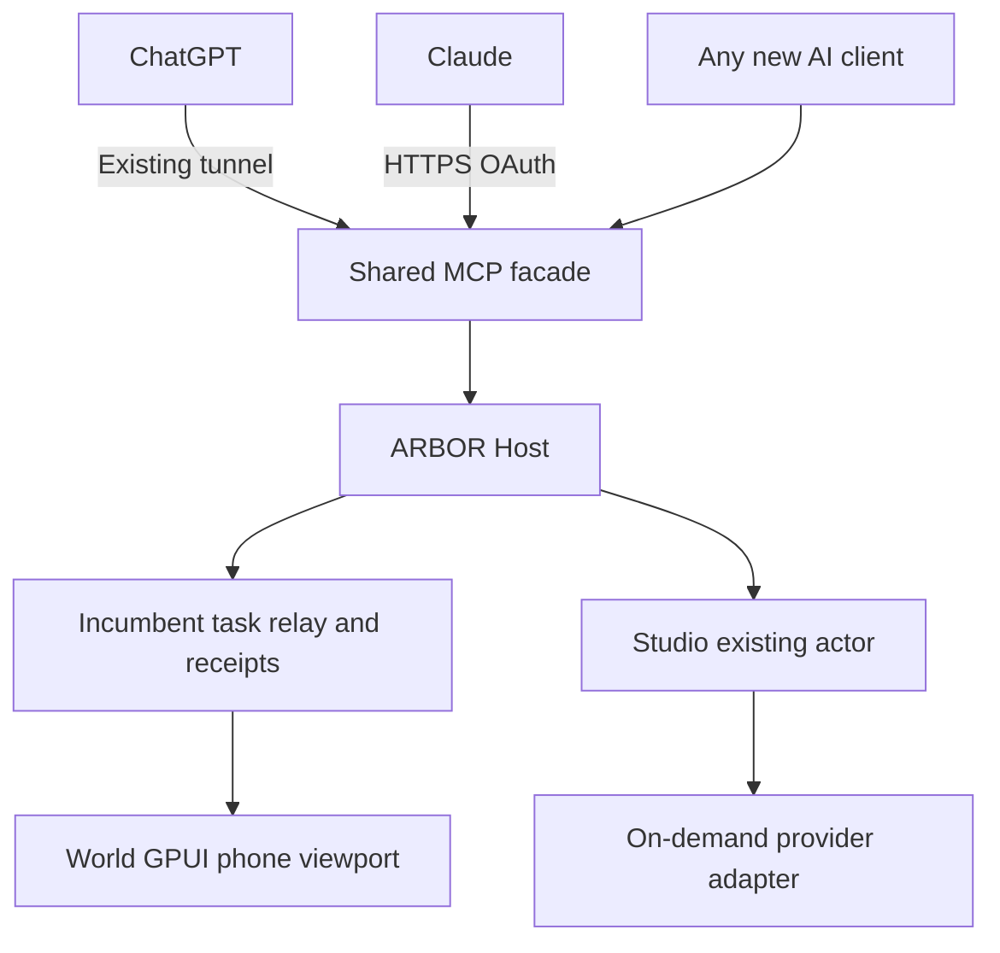

# PDR R002 — Native provider-open AI interoperability
2026-11-25 | P0 | Owner directive: fully permissive provider selection, add providers on demand, no provider gates.
Supersedes R001 rollout restrictions. Parent #32 AI-04–08; master #33 A04–16/U11/R07. No duplicate task ledger or execution owner.

## Product and invariant
Any provider, existing or newly added, may be selected immediately, with no hardcoded provider whitelist, provider admission committee, fixed rollout sequence, or global readiness gate. Claude is the first requested peer, not a prerequisite for others. An unavailable integration returns its actual local capability state; other providers remain operational. The same ordinary owner/account permissions, consent to external data sharing, effect receipts, and no duplicate send apply uniformly, independent of provider. No unauthorized costs or provider private APIs. One Host, existing Studio actor, existing World and native GPUI/PWA viewport. Registration of an MCP connector alone does not wake idle chat.

## Source audit (index baseline 158d0143a06be91465856a91d5f65ebd816c6f14)
- tools/mcp/vivim-arbor/server/tunnel-readonly.cjs (f72bebd32e9d958cbaebc8eb876a5913b5b15835): createProfile(env,{fetcher}), fixed health/discovery/probe, global initialization, 2025 revisions. Keep working tunnel; extend via scoped profile.
- server/remote-http.cjs (ff4ed47f730e03094bd4d9966eefad561c780b7f): loopback POST /mcp, 64KiB, 15s, four concurrent, discovery-only projector; not public Claude endpoint. Preserve existing boundary, use supported authenticated ingress.
- server/remote-grant.cjs (8d1250d1889e1ba5ffaa21be3fab98991e101ee3): fixed RS256 issuer/audience/subject, 900s, host-read scope only. Extend versioned client identity and conversation scopes; do not repurpose isolated probe.
- server/remote-policy.cjs (3377a2de72dc391a233238df2865f25d45aaaa8b): local fresh policy reads; preserve revocation and failure behavior.
- apps/vivim-host/control/universal-api.mjs (4892d4c8bd8480e400d21efe513bca26af41a802): discovery not effect authority; reuse incumbent dispatcher and journal.
- studio/src/studio/ai-router.mjs (61684025ad5741cc94c29bfe9e5fe3c555d9a631): existing pure router includes Claude, no duplicate registry.
- studio/src/studio/relay-chat-intent.mjs (c5a203ce03fb00903f74150198e8489fa4efd3b1): hardcoded four-provider list; remove provider whitelist, retain canonical prompt bytes and target conflict detection.
- studio/bin/lib/relay-chat-studio.mjs (ad401c2b57094ad39e030d1de7ad190547d9bff7): createStudioRelayChat({url,store,fetchImpl,isolatedChannel,channelRun}); explicitly rejects provider !== chatgpt; hardcoded origins and chatgpt-c UUID checks. Replace with generic provider adapter contract; isolated ChatGPT-only channel remains a capability of that adapter, not a global gate.
- studio/src/studio/relay-chat-startup-fence.mjs (fe139f94afbb86c02346aa1dc456d138954911b8): preserve historical-command fence.
- apps/vivim-host/conversations/bridge-evidence.mjs (9c9394087b6385556a0fa39b3af46b28698dfcb7): extend existing projection, no second store.
R018 handoff shows real fixed Node probe, not arbitrary Host calls. Claude account/readiness/reply and new transport unverified. Guessed stdio.cjs and conversation-service.mjs paths 404; locate actual owners before edits. Existing busy/uncertain ChatGPT work stays isolated; do not wait for it to add Claude or another provider.

## Research
Context7: /websites/platform_claude_en (API connector docs, distinct from web consumer); /websites/modelcontextprotocol_io_specification_2026-07-28 (OAuth discovery); /websites/rs_rmcp_rmcp (StreamableHttpService, request context, session managers).
- https://support.claude.com/en/articles/11175166-get-started-with-custom-connectors-using-remote-mcp
- https://developers.openai.com/plugins/deploy/connect-chatgpt
- https://modelcontextprotocol.io/specification/2026-07-28/basic/authorization
- https://blog.modelcontextprotocol.io/posts/2026-07-28/
- https://docs.rs/rmcp/latest/rmcp/transport/streamable_http_server/tower/struct.StreamableHttpService.html
Claude cloud needs externally reachable supported HTTPS MCP ingress; do not assume OpenAI's private tunnel accepts Anthropic. Keep existing connection; add Claude connector ingress to same Host. OAuth protected-resource metadata, issuer metadata, resource/audience-bound access tokens, client-specific identity, scopes, revocation. Negotiate actual protocol versions: current adapter 2025 only; 2026 changes session/sampling. No assumption of idle-client activation. Rust rmcp preferred after exact lockfile/version audit; maintain existing Node transport compatibility until proof. No endpoint fabricated.

## Architecture

Cooperative inbox works with both active clients without browser actuation. Active dispatch uses existing Studio turn actor, independently for any selected provider. No implicit fallback, no re-entry loop; cap hop count and execution budgets. Provider selection unrestricted; authorization of concrete effects is orthogonal. No separate browser controller, arbitrary URLs or cookies exposed.

## Wiring snippets — proposed, not compiled or deployed
### Rust typed contracts (reuse existing core crate)
```rust
use serde::{Deserialize, Serialize};
#[derive(Debug, Clone, Serialize, Deserialize)]
#[serde(transparent)]
pub struct ProviderId(pub String); // open identifier, not an enum or whitelist
#[derive(Debug, Clone, Serialize, Deserialize)]
#[serde(rename_all="snake_case")]
pub enum Mode { Inbox, Studio }
#[derive(Debug, Clone, Serialize, Deserialize)]
#[serde(deny_unknown_fields)]
pub struct Ask {
    pub request_id: String,
    pub conversation_ref: String,
    pub target: ProviderId,
    pub mode: Mode,
    pub prompt: String,
}
#[derive(Debug, Clone, Serialize, Deserialize)]
#[serde(rename_all="snake_case")]
pub enum State { AwaitingApproval, Queued, Claimed, Sent, AwaitingReply,
    Replied, FailedBeforeSend, Uncertain, Cancelled, Expired }
pub fn valid_id(s: &str) -> bool {
    !s.is_empty() && s.len() <= 96 &&
    s.bytes().all(|b| b.is_ascii_alphanumeric() || b"._-".contains(&b))
}
pub fn validate(a: &Ask) -> bool {
    valid_id(&a.target.0) && valid_id(&a.request_id) &&
    valid_id(&a.conversation_ref) && !a.prompt.trim().is_empty() &&
    a.prompt.len() <= 8192
}
```
No provider name is rejected by policy. Unknown provider is an adapter-discovery/install task, not a global error. Runtime may report adapter not installed, account not signed in, or thread unknown, without affecting any other provider. Bounds are proposed initial resource defaults, not provider gates.

### MCP tools and common transport facade
```js
// Illustrative adapter to existing Host, not a new authority or public endpoint.
// authenticated principal must originate from transport, never arguments.
const obj = (properties, required) => ({
  type: 'object', properties, required, additionalProperties: false
});
const id = {type:'string', minLength:1, maxLength:96};
const text = {type:'string', minLength:1, maxLength:8192};
const defs = {
 vivim_ai_request: obj({target:id, conversation_ref:id, request_id:id,
    mode:{type:'string',enum:['inbox','studio']},prompt:text},
    ['target','conversation_ref','request_id','mode','prompt']),
 vivim_ai_inbox: obj({conversation_ref:id,cursor:id},['conversation_ref']),
 vivim_ai_reply: obj({message_id:id,request_id:id,reply:text},
    ['message_id','request_id','reply']),
 vivim_ai_status: obj({operation_id:id},['operation_id']),
 vivim_ai_cancel: obj({operation_id:id},['operation_id'])
};
async function callBridge({name,args,transport,auth,validateSchema,host}) {
  if (!Object.hasOwn(defs,name)) throw Error('UNKNOWN_TOOL');
  validateSchema(defs[name],args); // actual UTF-8 byte limits also at Host
  const principal = await auth.currentPrincipal(transport);
  const result = await host.invokeScopedBridge({principal,name,args});
  await auth.revalidate(principal); // revocation before disclosure
  return {content:[{type:'text',text:JSON.stringify(result)}]};
}
```
Tool discovery returns schemas and accurate read/write annotations. Implement invokeScopedBridge as composition of incumbent Host plan/digest, scoped approvals, journal CAS and receipt mechanisms; no generic dispatch of caller-supplied action IDs. Request digest binds exact target, thread, bytes, owner/client, revision. Same request ID+digest returns original receipt, changed digest conflicts. Inbox is scoped to participant; reply must match assigned message. Status and cancel require operation ownership. Reply content is untrusted data, never execution authority.

### Rust HTTP integration sketch
```rust
// rmcp RequestContext exposes http::request::Parts injected by
// StreamableHttpService. Auth middleware attaches verified Principal.
// Illustrative handler fragment, types resolved at pinned SDK version.
async fn bridge_call(
    ctx: rmcp::service::RequestContext<rmcp::model::RoleServer>,
    input: Ask,
    host: &HostPort,
) -> Result<Status, BridgeError> {
    let parts = ctx.extensions.get::<http::request::Parts>()
        .ok_or(BridgeError::Unauthorized)?;
    let actor = parts.extensions.get::<Principal>()
        .ok_or(BridgeError::Unauthorized)?;
    if !validate(&input) { return Err(BridgeError::InvalidInput); }
    host.submit(actor, input).await
}
```
HostPort/Principal/Status/BridgeError denote proposed bindings to incumbent types. No token logging. TLS ingress and loopback transport distinct. Protocol tests include initialize, notifications/initialized where required, tools/list/call, request headers, GET/DELETE behavior by negotiated version, OAuth discovery, expired/revoked credentials, client isolation. Do not change live tunnel metadata until tested rollback; supported refresh then actual Claude registration.

### Studio generalization
```js
// Replace fixed provider checks with a selected existing-registry adapter.
// No provider whitelist; installed adapter capabilities describe actual mechanics.
async function resolveRequestedProvider(registry, provider) {
  const adapter = await registry.resolve(provider);
  if (!adapter) return {state:'adapter_needed',provider};
  return {state:'resolved',adapter};
}
async function runClaimedTurn({cmd,rec,registry,studio,host}) {
  const intent = parseRelayChatIntent(cmd); // generalize parser to open IDs
  const found = await resolveRequestedProvider(registry,intent.provider);
  if (found.state !== 'resolved') return host.recordLocalOutcome(cmd.id,found);
  const a = found.adapter;
  // Host supplies owned claim, no raw remote browser access.
  const binding = await studio.bindOwnedConversation(a,cmd,rec);
  await a.verifyAccountAndThread(binding);
  const receipt = await studio.sendOnce({binding,key:cmd.studioRequestKey,
    prompt:intent.prompt,claim:rec});
  // if submit may have occurred, reconcile read-only; never resend
  return host.projectVerifiedTurn(cmd.id,receipt);
}
```
Names above are proposed ports. Adapt actual createStudioRelayChat.handle flow: existing command/claim/key validation; canonical parse; prior outcome; provider-specific fresh and continuing identity; existing loopback /api/v1/conversations/create, /conversations/{id}/turns with key/prompt/confirm/expectedRevision, then GET conversation until settled; verify provider, conversation ID, exact target and turn key, origin and provider-specific thread proof; existing finish only when safe. Existing ChatGPT isolatedChannel only supports its own thread contract; route Claude via its real existing Studio adapter without post-uncertainty fallback. Preserve startup fence and read-only reconciliation. Extract identity rules into adapters, not remove them. Discover providers using existing registry and local adapter lifecycle; explicit target never silently substituted.

## Acceptance and work order (parallel, no sequential provider gates)
B01 transport: retain ChatGPT, implement Claude-compatible endpoint, register connector, actual independent health calls; other providers can register concurrently.
B02 core: open provider ID, remove hardcoded parser list/worker singleton restriction, reuse adapter registry; unknown ID yields adapter-needed only for that request. Test new arbitrary valid ID and existing provider regression.
B03 Host: scoped cooperative inbox and five tools, idempotency, revocation, expiry, cancellation, restart, bounded trace. Real cross-client challenge with reply and receipt, both directions; both active clients initiate tool calls.
B04 Studio: requested provider adapter implementation on demand; Claude independently of ChatGPT reconciliation or Gemini/Qwen. Verify actual account/thread/composer/readback, one send, settled real reply, continuation; uncertain outcomes never retried. Tests and real acceptance evidence are verification, not scheduling gates.
B05 native projection: existing World/GPUI/phone shows participants, thread, status, reply and receipt; no second renderer.
B06 extension: register arbitrary next provider without editing fixed provider lists; no full catalogue completion requirement. Each adapter's actual capability/readiness independent; no global readiness switch.
B07 release: exact source SHA tests, live tool listings, real receipt, rollback, no secret exposure, no unapproved API charges.
Ownership: existing L01/Studio and #32 owner for browser adapter; current Host owner for journal/catalog; Session 04 MCP transport; L02 GPUI. Reconcile TASK-CLAIMS before source edits; no new concurrent writer.
Status: DESIGN ONLY. No runtime changes, provider gate removal in production, Claude endpoint, live connector or AI reply yet. Tracker work remains open; no artificial sequential provider blocker.
