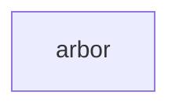
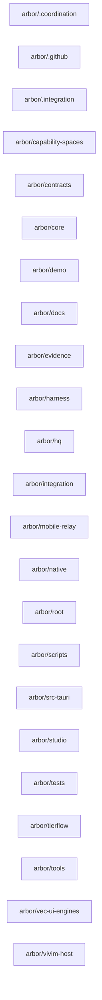

# Dependency graph

> Generated 2026-11-19 · project and module level

Edges are aggregated resolved imports. External packages are omitted.

## Projects

| From | To | Imports |
| --- | --- | --- |

## Modules

| From | To | Imports |
| --- | --- | --- |

---

[HQ wiki](./index.md) · [Symbols](./symbols.md) · [Dependency graph](./graph.md) · [Documentation](./docs.md) · [Changes](./changes.md) · [Open tasks](./todos.md) · [Deprecated](./deprecated.md) · [Agent annotation protocol](./protocol.md) · [Glossary](./glossary.md) · [Using HQ](./context.md) · [Capabilities](./capabilities.md) · [Search index](./search.json) · [Browser view](./index.html)
